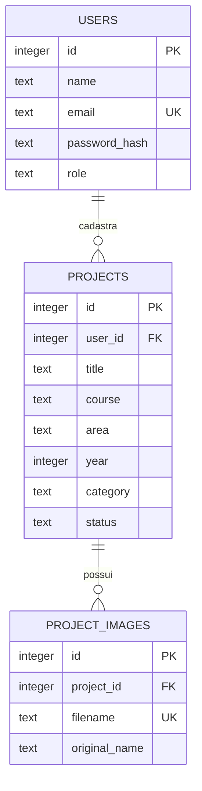

# Arquitetura da Vitrine Virtual

## Decisões da implementação

O documento de referência não define linguagem, framework ou SGBD. Esta entrega usa Python, Flask, HTML, CSS, JavaScript e SQLite para permitir execução local com poucas dependências. Flask organiza as rotas em módulos, Jinja gera as páginas HTML e SQLite persiste os dados. Não há necessidade de compilar o frontend ou instalar Node.js para usar o sistema.

O servidor usa o padrão de fábrica `create_app`, permitindo configurações diferentes para a aplicação e os testes. Cada requisição abre sua própria conexão com o banco, que é fechada ao concluir a resposta. As páginas públicas consultam apenas projetos publicados.

## Relação entre as entidades

`projects` também armazena resumo, descrição, resultados, equipe, orientação, contatos, links e datas. `project_images` guarda referências para arquivos processados, não o conteúdo binário das imagens. A tabela auxiliar `login_attempts` registra tentativas inválidas por endereço IP e horário, sem armazenar as senhas informadas.

## Permissões

| Ação | Visitante | Aluno ou professor | Responsável pelo projeto |
| --- | --- | --- | --- |
| Consultar projetos publicados e imagens | Sim | Sim | Sim |
| Buscar e filtrar | Sim | Sim | Sim |
| Cadastrar projeto | Não | Sim | Sim |
| Consultar rascunho e suas imagens | Não | Não, se for de outro usuário | Sim |
| Editar e excluir | Não | Não, se for de outro usuário | Sim |
| Publicar e voltar para rascunho | Não | Não, se for de outro usuário | Sim |

O responsável é o usuário que cadastrou o projeto. Os integrantes informados no campo equipe são dados de divulgação; esse campo não concede permissões de edição a outras contas.

## Formulários e imagens

Todas as alterações são feitas por POST com token CSRF. O backend repete a validação dos campos mesmo que o navegador já os valide. Senhas são armazenadas como hash pelo Werkzeug. Conteúdos dos usuários são escapados pelo Jinja; a aplicação não aceita HTML formatado em descrições.

Imagens são abertas pelo Pillow, verificadas e convertidas em JPEG. A conversão reduz a dimensão máxima para 1920 pixels e remove os metadados originais. O nome armazenado é aleatório. Imagens de rascunhos são servidas apenas ao responsável, passando pelo mesmo controle de acesso do projeto. Os arquivos não ficam dentro da pasta pública `static`.

O cadastro e as imagens são gravados em conjunto; falhas de validação não criam projetos. Falhas durante a gravação provocam rollback e limpeza das novas imagens. Ao excluir um projeto, as referências de suas imagens são removidas por chave estrangeira e os arquivos também são apagados.

## Requisitos do documento

| Requisito descrito | Implementação |
| --- | --- |
| Cadastro de usuários | `auth.py`, telas de cadastro e login, tabela `users` |
| Cadastro de projetos | `projects.py`, formulário de projeto, tabela `projects` |
| Publicação de resumos | Resumo obrigatório exibido em cards e nos detalhes |
| Publicação de resultados | Campo de resultados, exibido nos detalhes |
| Publicação de imagens | Upload validado, capa e galeria |
| Contatos | E-mail público e telefone opcionais |
| Links para repositórios | URL de repositório com botão para acesso externo |
| Pesquisa e filtros | Busca textual e filtros combinados por curso, área e ano |
| Ensino, pesquisa e extensão | Classificação e filtro por tipo |
| Consulta pela comunidade | Catálogo e detalhes sem cadastro obrigatório |
| Quantidade de projetos | Contadores de projetos, cursos e áreas no catálogo |
| Testes funcionais | Suíte automatizada em `tests/` |
| Orientação dos usuários | README e roteiro de apresentação |

## Rotas

| Método | Endereço | Uso |
| --- | --- | --- |
| GET | `/` | Catálogo com parâmetros `q`, `course`, `area`, `year`, `category`, `page` |
| GET | `/sobre` | Apresentação da proposta |
| GET e POST | `/conta/cadastro` | Cadastro de usuário |
| GET e POST | `/conta/entrar` | Login |
| POST | `/conta/sair` | Logout |
| GET | `/meus-projetos` | Projetos do usuário autenticado |
| GET e POST | `/projetos/novo` | Cadastro de projeto |
| GET | `/projetos/<id>` | Detalhes do projeto |
| GET e POST | `/projetos/<id>/editar` | Edição pelo responsável |
| POST | `/projetos/<id>/excluir` | Exclusão pelo responsável |
| GET | `/imagens/<filename>` | Imagem com verificação de visibilidade |

Não há API JSON separada nesta versão. As rotas são usadas por páginas e formulários HTML.
